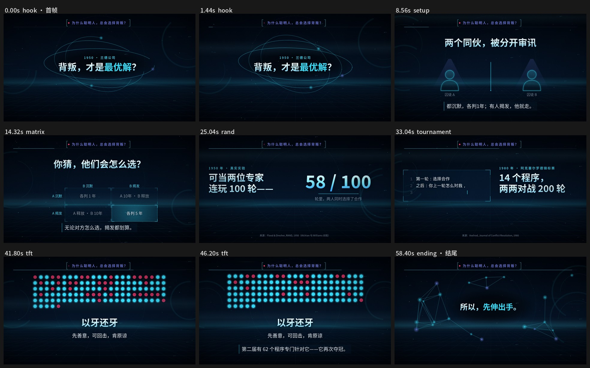

# zheban-video

**这班让 AI 上 · 知识短片**

把一个知识点做成一支能看、能听、能继续修改的短片。

这是「这班让 AI 上」在实际做视频时整理的 Agent Skill。起点是用 Claude 做出几条满意的知识短片，再把制作方法、画面代码和导出工具留下来，之后拿到 Codex 里测试不同风格。

它通过代码绘制动画，交付 MP4、分镜、事实记录和可重建源码包。适合解释概念、关系、数据变化与真实故事。

## 六种视觉风格

| 风格 | 适合的画面语言 | 示例预览 |
| --- | --- | --- |
| 暗金 `noir-gold` | 金属、光影、人物选择与揭晓 | [查看](examples/style-variants/noir-gold-portrait.jpg) |
| 水墨 `ink-wash` | 宣纸、山水、自然与结构关系 | [查看](examples/style-variants/ink-wash-portrait.jpg) |
| 科技数据 `tech-hud` | 网格、数据、单位与机制 | [查看](examples/style-variants/tech-hud-landscape.jpg) |
| 档案纪实 `archive-doc` | 纸面、字块、历史过程 | [查看](examples/style-variants/archive-doc-landscape.jpg) |
| 极简瑞士 `swiss-minimal` | 排版、图表与清晰比较 | [查看](examples/style-variants/swiss-minimal-portrait.jpg) |
| 星空宇宙 `cosmic-blue` | 深蓝空间、轨道与尺度 | [查看](examples/style-variants/cosmic-blue-landscape.jpg) |



预览图展示内置视觉预设。新主题的构图、叙事和专属图解仍由执行模型设计。

## 安装 Skill

把下面这句话发给你正在使用的 Claude Code、Codex 或其他支持本地 Skill 的 Agent：

> 帮我安装这个 Skill：https://github.com/workagi/zheban-video 。Skill 名称是 zheban-video，请按当前环境的 Skill 安装规则安装完整目录，并检查是否能被识别。

也可以在终端使用 [Skills CLI](https://github.com/vercel-labs/skills) 安装：

```bash
npx skills add workagi/zheban-video --skill zheban-video -g
```

按安装器提示选择要使用的 Agent，推荐使用链接方式共享同一份 Skill。此安装器需要 Node.js 22.20 或更新版本；不加 `-g` 时只安装到当前项目。已有共享安装方案的环境，沿用原来的安装规则，详见 [INSTALL.md](INSTALL.md)。

## 安装后怎么用

安装完成后，在 Agent 中点名使用 `zheban-video`，交代主题、时长、横竖屏、视觉风格和声音需求。Agent 会先检查制作环境，再核对事实、整理分镜，生成预览后继续制作 MP4。

首次使用时让 Agent 检查渲染依赖与字体；Skill 安装完成不代表运行依赖已齐全。若当前对话没有识别到新 Skill，新开一次对话后再使用。

六种风格可按名称选择。先用自己熟悉的知识点做一条，看片和试听后，再指出具体位置继续修改。安装与依赖说明见 [INSTALL.md](INSTALL.md)。

## 做了哪些事

- Canvas 按时间确定性绘图，经 Playwright 逐帧渲染，再用 FFmpeg 导出 H.264 + AAC。
- 支持横屏、竖屏，配乐、音效、已有旁白及可选 Edge TTS。
- 对事实来源记录、文字遮挡、读速、成片解码、响度和动态异常做技术检查。
- 保留源码、素材引用和检查报告，方便指出具体位置继续改。
- 暗金横屏另有三个固定镜头实现，可复用奖章揭晓、上一轮复制和排名比较。

运行依赖 Node.js 18+、Python 及 NumPy/Pillow、Playwright/Chrome、FFmpeg，以及对应中文字体。字体、配音和外部素材按示例中的说明另行准备；仓库不捆绑这些依赖。

## 现在的边界

Skill 可以保存已经实现的画面和制作步骤。换到其他模型后，选题、事实核查、镜头设计与完成度仍会变化；它不承诺复现 Claude 原片，也不承诺一次直出。

六种视觉预设可以用于新项目，但固定镜头的验证范围目前只有暗金横屏的上述三类。遇到新关系、新题材或更高的参考标准，仍需制作专属画面并实际检查。

来源检查验证的是记录是否齐全，自动质检也不能代替事实核查、看片和试听。可选 Edge TTS 会把旁白文本发送到微软在线服务，不提供音色克隆。

## 验证

仓库保留现有测试和示例。发布时检查了名称、依赖入口、已有单元测试及最小浏览器渲染；具体结果见 [VALIDATION.md](VALIDATION.md)。示例中已有的 QA 报告是原制作记录，不代表本次重新渲染了所有影片。

代码采用 [MIT License](LICENSE)。示例中的事实来源归原作者，字体、音频与其他外部素材遵循各自许可。
